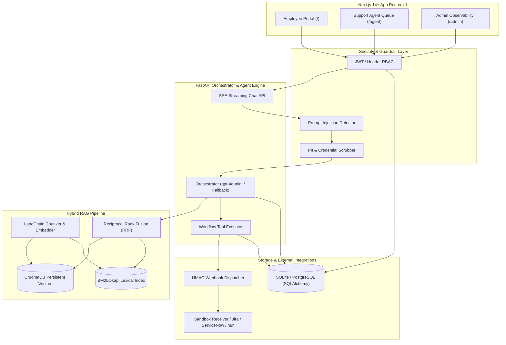
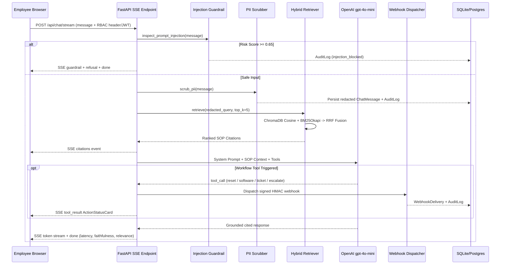
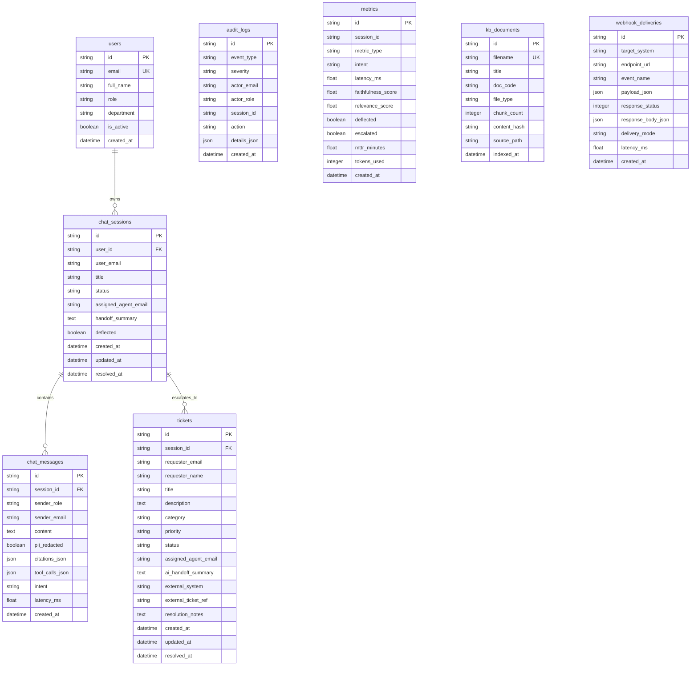

# AI-HAS System Architecture & Design

## 1. High-Level System Architecture

The **AI-Powered Enterprise Helpdesk & Workflow Automation System (AI-HAS)** follows a layered, security-first microservice-ready architecture linking a Next.js 14+ multi-role UI, a FastAPI orchestrator, a Hybrid RAG knowledge engine (ChromaDB + BM25), OpenAI `gpt-4o-mini` function calling, and signed ITSM webhooks.

---

## 2. Hybrid RAG Pipeline & Guardrail Execution Flow

Every chat turn enforces a deterministic safety-and-grounding pipeline before any LLM call or operational workflow executes:

---

## 3. Relational Database Schema

AI-HAS uses SQLAlchemy 2.0 models compatible with SQLite (local zero-config default) and PostgreSQL:

---

## 4. Enterprise Security Guardrails
- **RBAC Enforcement:** Every endpoint verifies either a signed `HS256` JWT Bearer token (`Authorization: Bearer <token>`) or local dev headers (`X-User-Role`, `X-User-Email`) when `ALLOW_HEADER_ROLE_AUTH=true`. Unauthorized attempts generate `rbac_denied` audit entries and HTTP `403`.
- **PII & Secret Scrubbing:** SSNs, Luhn-valid credit cards, IPv4 addresses, phone numbers, email addresses, API keys (`sk-`, `ghp_`, `AKIA`, `xox*`), and inline credentials (`password=...`) are scrubbed prior to OpenAI transmission and SQLite/PostgreSQL storage.
- **Prompt Injection Defense:** NFKC Unicode normalization, zero-width character stripping, Base64 payload decoding, and weighted regex heuristics block instruction overrides, DAN jailbreaks, template delimiter spoofing, and secret exfiltration.
